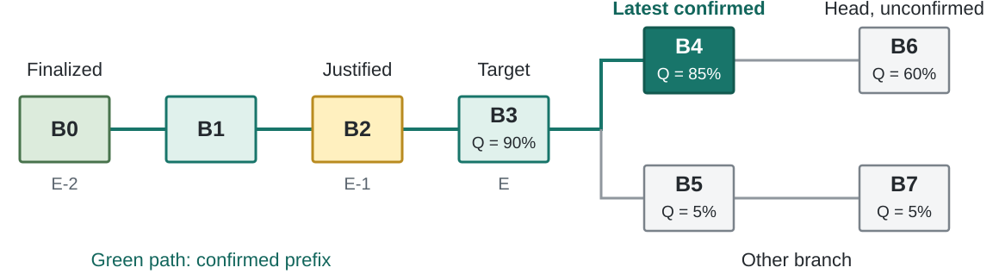
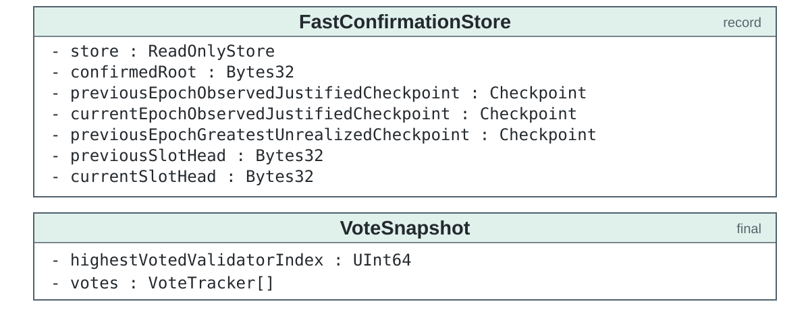
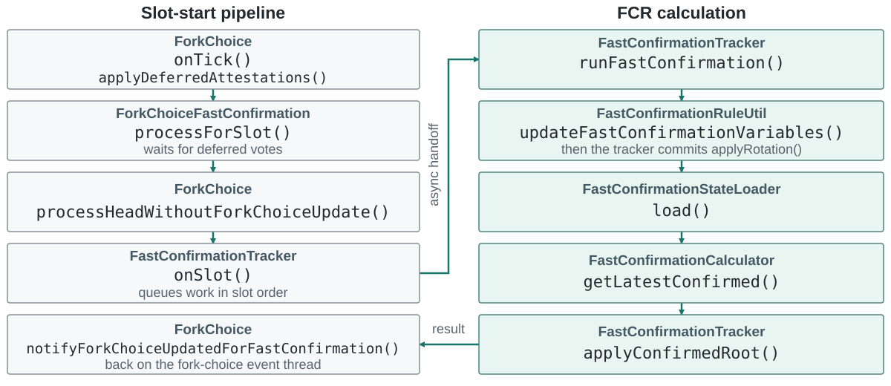
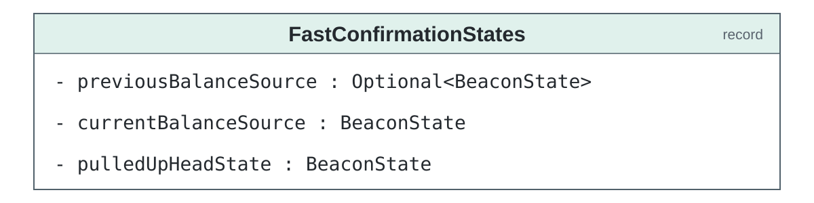
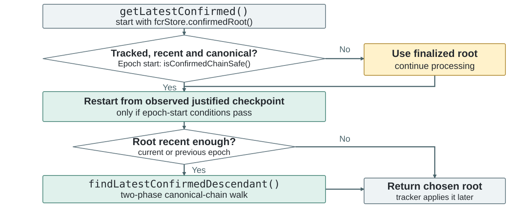
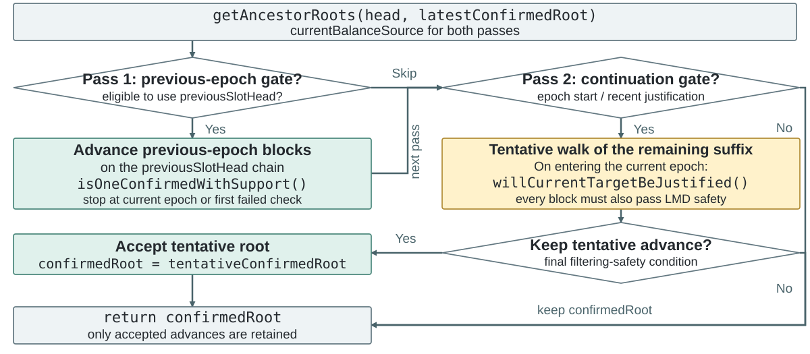
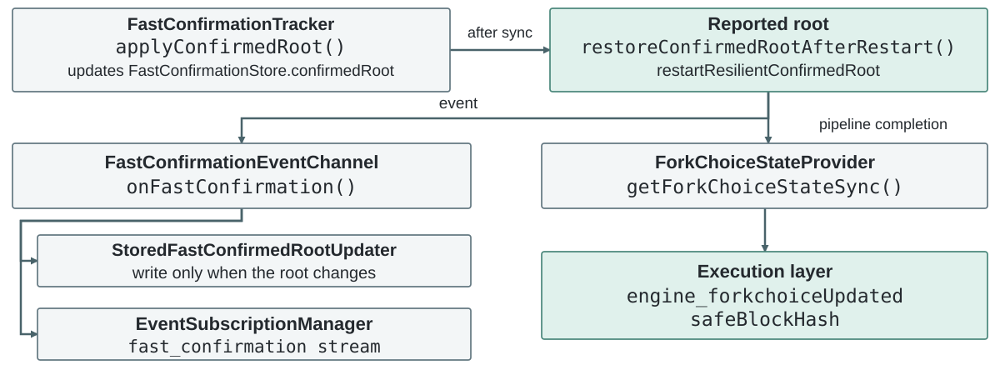

<!-- _paginate: false -->

# Fast Confirmation Rule

---

# FCR Overview

- Confirms blocks before finalization.
- Assesses reorg safety using additional synchrony assumptions.
- Complements finality without replacing it.

<!--
Assesses reorg safety using additional synchrony assumptions...but uses weaker adversarial threshold, covered later
-->

---

# FCR Properties

Under the required safety and liveness assumptions:

- **Safety:** No conflict with any honest validator's canonical chain.
- **Monotonicity:** Later confirmations extend the already-confirmed chain.
- **Eventual finalization:** Confirmed blocks eventually become finalized.

<!--
Monotonicity: if block 0 is confirmed, nothing happening to a later block 10
can remove confirmation from block 0, while the FCR safety assumptions hold.
-->

---

# Confirmation Threshold

Simplified model under the FCR safety assumptions.

$\beta$: maximum assumed adversarial share of voting weight.

$$
Q(B) := \frac{S(B)}{W} > \frac{1}{2} + \beta
$$

$$
\Longrightarrow \quad P(B) := \frac{H(B)}{J} > \frac{1}{2(1-\beta)}
$$

**Then $B$ remains canonical forever.**

$S(B), H(B)$: total and honest support for $B$.
$W, J$: total and honest voting weight.

<!--
Based on the equations in the supplied Roberto Saltini presentation screenshot.
This is a simplified voting-weight argument, not the full production FCR predicate.
The canonicality conclusion assumes the model's synchrony and ancestor-safety
conditions. Ethereum FCR additionally accounts for FFG viability, proposer boost,
committee timing, and the required ancestor checks.
-->

<!--
Teku beta (verified in the local checkout on 2026-11-17):

Beta is hardcoded to 25% (0.25), not merely a configurable default.
Stronger assumptions, but lower fault tolerance than FFG finality: FCR assumes
at most 25% adversarial weight and the required network synchrony. FFG finality's
standard safety guarantee tolerates adversarial weight below one-third without
requiring synchrony. FCR gets earlier confirmation under these stronger assumptions.

Not 100% sure on the reason why these constant was chosen but earliest FCR
version from older rule had timings like 0.2 55 seconds, 0.25 58 seconds, 0.3 82 seconds.
So 0.25 was chosen like running still in a moderate amount of time but with stronger
assumptions than 0.2. Today FCR version with optimizations have timing like 0.25 8 seconds,
0.33 13 seconds, so we could bump default spec version or at least add a command line flag 
to let the user choose.

The constant is FastConfirmationRuleUtil.CONFIRMATION_BYZANTINE_THRESHOLD = 25.
Source: https://github.com/Consensys/teku/blob/master/ethereum/statetransition/src/main/java/tech/pegasys/teku/statetransition/forkchoice/fastconfirmation/FastConfirmationRuleUtil.java#L42

This value follows the FCR spec's default and maximum of 25%.
Teku does not obtain beta from beacon state, a CLI option, or network YAML.
It is not wired through SpecConfig. A network YAML entry with this name does
not override the constant used by the current implementation.

FastConfirmationCalculator uses the constant directly when computing maximum
adversarial weight and the remaining honest FFG weight. Changing beta currently
requires a code change, or adding proper SpecConfig support.
-->

---

# Three Pillars of Confirmation

**1. Justification (FFG)**  
The current target will become justified.  
`will_current_target_be_justified`

**2. Fork-choice filtering**  
The branch remains eligible across epoch boundaries.  
`get_voting_source` + `will_no_conflicting_checkpoint_be_justified`

**3. Safety (LMD-GHOST)**  
The block and required ancestors exceed the safety threshold.  
`is_one_confirmed` + `compute_safety_threshold`

<!--
Source: consensus-specs/specs/phase0/fast-confirmation.md.
These are conceptual pillars, not three independent predicates that must all
return true on every path through the algorithm.

find_latest_confirmed_descendant combines the checks. When advancing into the
current epoch, it calls will_current_target_be_justified, which requires projected
honest FFG support of at least two-thirds of total active balance.

Filtering safety combines voting-source freshness, head unrealized justification,
and will_no_conflicting_checkpoint_be_justified. The latter accepts an already
unrealized-justified current target or projected honest FFG support above one-third.
The exact conditions depend on the block epoch and whether this is an epoch's
first slot. filter_node_tree is the underlying fork-choice eligibility filter,
not itself a test that a branch will remain eligible in future epochs.

is_one_confirmed compares observed support with compute_safety_threshold and is
applied along the relevant ancestor chain. get_latest_confirmed also invokes
is_confirmed_chain_safe at epoch boundaries to recheck previously confirmed blocks.
-->

---

# Which Blocks Can We Confirm?

Illustrative snapshot: $\beta=25\%$, simplified threshold $Q(B)>75\%$. FFG gates pass.



**Confirm through B4. Head B6 remains unconfirmed.**

<!--
The example follows the threshold and three-pillars slides so it can apply both.
All numbers are illustrative, not measurements or an exact Teku replay.

Read the graph from left to right. B0 is finalized. B2 is the previous epoch's
justified checkpoint and the starting confirmed anchor. B1 is on its ancestor
chain. B3 is the current epoch's target checkpoint, not yet justified.

LMD support: the percentages use the preceding slide's simplified fixed-window
model, with a common voting-weight denominator W. For this illustration, latest
votes of weight 60% of W point to B6, 25% point to B4 itself, 5% point to B7,
and 10% are not observed. Descendant votes also support ancestors. Thus B3 has
90% support, B4 has 85%, B6 has 60%, and the B5-B7 branch has 5%.

With beta = 25%, the simplified strict threshold is Q > 75%. B3 and B4 pass.
B6 fails. LMD-GHOST can still choose B6 as head: it follows the heavier B4
branch, then B6 as its only child. Being head does not imply being confirmed.
The confirmed prefix is B0-B1-B2-B3-B4. B6 may become confirmed later as more
support arrives, but it is not confirmed in this snapshot.

FFG and filtering assumptions for this example, in a non-boundary slot of epoch E:
- store.unrealized_justifications[head] is checkpoint (E-1, B2), satisfying the
  recent-justification gate in find_latest_confirmed_descendant.
- Both fork branches share current target B3. Votes on either branch can therefore
  support B3 as the FFG target, even though their LMD head votes disagree.
- Let T be total active balance. Half of the current epoch's FFG voting weight
  has been assigned, and get_current_target_score returns 0.45*T. The projected
  honest FFG support is (0.45 - 0.25*0.50 + 0.75*0.50)*T = 0.70*T.
- This is at least 2*T/3, so will_current_target_be_justified passes when the walk
  enters B3's epoch. It is also above T/3, satisfying the support alternative in
  will_no_conflicting_checkpoint_be_justified where that check is needed.

There are no "unrealized votes" here. Unrealized justification is calculated from
attestations already included in a branch's state. Projected honest FFG support
combines observed votes with assumed future honest support. B2 is unrealized
justified in the head's view; B3 is only predicted to become justified.

Assume all relevant blocks are execution-valid and the FCR safety assumptions
hold. In the full specification, is_one_confirmed compares each block's support
with its own compute_safety_threshold, accounting for committee timing, proposer
boost and support discounts. The shared 75% threshold is only the teaching model.
The production confirmation walk also checks the required ancestors and FFG
conditions. Under the illustrated checks, it stops at B6 and returns B4.
-->

---

# Teku Implementation

**Fork-choice integration**  
`ForkChoiceFastConfirmation` connects `ForkChoice` to the FCR tracker.  
`FastConfirmationTracker` runs `FastConfirmationCalculator` off-thread.

**When it runs**  
`ForkChoice.onTick`: new slot, deferred votes, then head selection.  
FCR runs next, followed by the slot-start `forkchoiceUpdated`.

<!--
Scope: Teku implementation inspected at commit
0a29604edc5566c0a538dac47f828a2e61db9c2a.

Enablement and integration:
- Eth2NetworkOptions exposes --Xfast-confirmation-enabled. The default in
  Eth2NetworkConfiguration is false in the inspected implementation.
- BeaconChainController creates an AsyncRunner named "fastconfirmation" with
  one worker, constructs FastConfirmationTracker, and supplies it to ForkChoice.
  When disabled it supplies FastConfirmationTracker.NOOP.
- ForkChoice owns the tracker and a ForkChoiceFastConfirmation service, which
  BeaconChainController starts and stops with the other beacon services.
- Store initialization calls FastConfirmationTracker.initialize, seeding
  FastConfirmationStore from the finalized checkpoint.

Mainnet timing (the pre-Gloas schedule in the inspected configuration):
- Slots are 12 seconds long. Take the start of slot n as t = 0 seconds.
- t = 0: the proposer is expected to publish block n.
- t = approximately 4 seconds: attestation deadline. Validators may attest
  earlier after receiving a valid block.
- t = approximately 8 seconds: aggregate-attestation deadline.
- t = 12 seconds, which is second 0 of slot n+1: Teku schedules the FCR pipeline
  after applying deferred votes and selecting the head. A timely block n may
  become confirmed here, about 12 seconds after proposal or 8 seconds after the
  usual attestation deadline, plus processing time. Confirmation is conditional
  on the checks passing, not guaranteed for every block.
- An epoch is 32 slots = 384 seconds (6 minutes 24 seconds). The epoch-boundary
  reconfirmation therefore runs at the start of each such interval.
These timings follow mainnet SLOT_DURATION_MS = 12000, ATTESTATION_DUE_BPS = 3333,
AGGREGATE_DUE_BPS = 6667, and SLOTS_PER_EPOCH = 32. Gloas has different attestation
offsets but is not scheduled in the inspected mainnet configuration.

This is scheduled at slot start, not guaranteed to finish at second zero.
It is not a fresh FCR calculation on every arriving block or attestation.
Stale or duplicate slots are ignored, and loading/computation has timeout and
stale-head guards. Epoch-start runs also recheck the confirmed chain.

Proposal-slot exception: prepareForBlockProduction can advance the store before
the regular tick. updateFastConfirmationForProposalSlot therefore calls onSlot
using the pre-override canonical head, so that slot is not missed. The tracker
deduplicates it. This path is fire-and-forget, does not block proposal production,
and does not send an extra forkchoiceUpdated of its own.
-->

---

# FCR Data Structures



<!--
Data structures and scoring:
- FastConfirmationStore is a separate record referencing the existing
  ReadOnlyStore. It keeps confirmedRoot, previous/current slot heads,
  previous/current observed justified checkpoints, and the previous epoch's
  greatest unrealized checkpoint. It is not another copy of the block tree.
- Store.getVoteSnapshot copies the committed vote array under the store's vote
  read lock. FastConfirmationCalculator uses this VoteSnapshot rather than
  repeatedly reading a changing vector. This is not a deep snapshot of the
  entire fork-choice store: the slot head root is captured first, and the vote
  snapshot is obtained when the calculator is constructed after state loading.
- The calculator computes FCR support from latest votes and the appropriate
  balance source, walks the canonical suffix, and keeps per-run score caches.
  It does not add a second persistent weight or confirmation flag to every node.
- FastConfirmationStateLoader loads the current balance source and pulled-up
  head state. It also requests the previous balance source at epoch boundaries
  for reconfirmation, combining them in FastConfirmationStates. These loads use
  the existing store's block/checkpoint-state caches.
- Store also exposes the root loaded from before restart.
  StoredFastConfirmedRootUpdater persists changes to the reported confirmed root
  through a store transaction, subscribing to FastConfirmationEventChannel.
  Reporting starts only after the node has first reached sync since startup.

Source files in the Teku repository:
- services/beaconchain/.../BeaconChainController.java
- ethereum/statetransition/.../forkchoice/ForkChoice.java
- ethereum/statetransition/.../forkchoice/fastconfirmation/ForkChoiceFastConfirmation.java
- ethereum/statetransition/.../forkchoice/fastconfirmation/FastConfirmationTracker.java
- ethereum/statetransition/.../forkchoice/fastconfirmation/FastConfirmationCalculator.java
- ethereum/statetransition/.../forkchoice/fastconfirmation/FastConfirmationStateLoader.java
- ethereum/spec/.../forkchoice/FastConfirmationStore.java and VoteSnapshot.java
- storage/.../store/Store.java and protoarray/ProtoNode.java
-->

<!--
Fields-only class diagrams:
Source: ethereum/spec/src/main/java/tech/pegasys/teku/spec/datastructures/forkchoice/FastConfirmationStore.java
Source: ethereum/spec/src/main/java/tech/pegasys/teku/spec/datastructures/forkchoice/VoteSnapshot.java

Store.getVoteSnapshot creates this copy while holding readVotesLock, so it sees
committed vote state. StoreTransaction.getVoteSnapshot delegates to Store and
does not include that transaction's pending vote updates.

FastConfirmationCalculator obtains one VoteSnapshot for its calculation and
reuses it for scoring. Later committed vote replacements are visible only to a
new snapshot. This stabilizes the vote vector, not the whole fork-choice tree
or every other piece of store state. Snapshot creation happens when the calculator
is constructed, after its source states have loaded, not atomically with the
earlier slot-start head selection.

previousEpochGreatestUnrealizedCheckpoint: a holding value. It is written only on the last slot of an epoch: getGreatestUnrealizedJustifiedCheckpoint takes the store's justified checkpoint and raises it to the highest unrealized justified checkpoint of any block in fork choice. Its only use is to become currentEpochObservedJustifiedCheckpoint at the next epoch start.
-->

---

# FCR Call Flow



<!--
Normal slot-start path, with FCR enabled, a usable head and available source states.
The arrows show execution order across method calls and asynchronous continuations,
not one synchronous call stack. Read down the left side, follow the async handoff
to the top right, then follow the result back to the bottom left.

1. ForkChoice.onTick advances store time. On a new slot it starts
   applyDeferredAttestations and passes that future to
   ForkChoiceFastConfirmation.processForSlot.
2. processForSlot chains this slot after the previous one and waits for deferred
   attestations before invoking ForkChoice.processHeadWithoutForkChoiceUpdate.
   That wrapper calls processHead without sending the slot-start fcU yet.
3. Once a head is available, processForSlot invokes FastConfirmationTracker.onSlot
   with the slot and head root.
4. onSlot queues work on the fast-confirmation runner. It invokes
   processFastConfirmationInput, which checks for stale/duplicate slots, then
   calls runFastConfirmation. The diagram abbreviates these internal wrappers.
5. runFastConfirmation derives epoch-boundary information and calls
   FastConfirmationRuleUtil.updateFastConfirmationVariables. The tracker then
   calls applyRotation, committing the updated slot heads and checkpoints before
   the potentially slow confirmation calculation.
6. FastConfirmationTracker.computeConfirmedRoot calls FastConfirmationStateLoader.load.
   The load combines the current balance source, pulled-up head state, and the
   optional previous balance source for epoch-start reconfirmation. Loading is
   asynchronous and uses the existing store's runners and caches.
7. The continuation resolveConfirmedRoot constructs FastConfirmationCalculator.
   Its constructor obtains Store.getVoteSnapshot. It then calls getLatestConfirmed,
   which performs the reconfirmation/restart checks and, when allowed, calls
   findLatestConfirmedDescendant to walk the canonical suffix using the LMD and
   FFG checks from the earlier slides.
8. FastConfirmationTracker.applyConfirmedRoot folds the result into the rotated
   FastConfirmationStore. Once initial sync has completed, it also derives the
   restart-resilient reported root and publishes FastConfirmationEventChannel.
   Persistence is handled by the existing event subscriber.
9. Completion returns to processForSlot's continuation, which invokes
   ForkChoice.notifyForkChoiceUpdatedForFastConfirmation. That method schedules
   the notification on the fork-choice event thread. ForkChoiceStateProvider
   supplies the confirmed root for the safe execution block hash.

The state-loading continuations can execute on completion threads, so the entire
right column is not necessarily one uninterrupted task on a single thread.
The slot pipeline is asynchronous and updates are serialized by slot.

Timeouts, unavailable states, stale heads, missing heads and the proposal-slot
entry path are omitted from the diagram. They are covered in the implementation
notes. onFastConfirmation is a separate test entry point and is not the production
slot-start entry shown here. None of this adds a new VoteTracker representation.

Sources in the Teku repository:
- ethereum/statetransition/.../forkchoice/ForkChoice.java
- ethereum/statetransition/.../forkchoice/fastconfirmation/ForkChoiceFastConfirmation.java
- ethereum/statetransition/.../forkchoice/fastconfirmation/FastConfirmationTracker.java
- ethereum/statetransition/.../forkchoice/fastconfirmation/FastConfirmationStateLoader.java
- ethereum/statetransition/.../forkchoice/fastconfirmation/FastConfirmationCalculator.java
-->

---

# FCR State Inputs

`FastConfirmationStateLoader` prepares these inputs for the calculator.



<!--
FastConfirmationStates is a record containing the beacon-state inputs for one
FCR calculation. It does not introduce a new beacon-state format or copy the
whole chain. These are three logical roles, not necessarily three distinct
state objects: checkpoint sources can coincide.

previousBalanceSource: Optional<BeaconState>
- Loaded from store.retrieveCheckpointState with
  fcrStore.previousEpochObservedJustifiedCheckpoint().
- Requested only when atEpochStart is true. On ordinary slots it is deliberately
  Optional.empty(), avoiding an unnecessary retrieval.
- Used by is_confirmed_chain_safe to re-evaluate the already-confirmed chain
  against the previous balance source at an epoch boundary.
- It may also be empty at an epoch start if the checkpoint state is unavailable.
  That does not fail the entire load. Reconfirmation decides whether it needs
  that source, and fails if it has blocks to score but cannot obtain the source.

currentBalanceSource: BeaconState
- Loaded from store.retrieveCheckpointState with
  fcrStore.currentEpochObservedJustifiedCheckpoint().
- Required for the returned record. It supplies the validator balances used to
  evaluate candidate confirmations, including their LMD support and thresholds.
- "Current" means the source selected for this epoch's calculations, not that
  this checkpoint or its state necessarily belongs to the current epoch.
- The preceding updateFastConfirmationVariables step has already rotated the
  observed checkpoint roles when this is an epoch-start run.

pulledUpHeadState: BeaconState
- Required for the returned record. This is the state for the selected slot head,
  advanced to the current epoch's start only if that head predates the epoch.
- If the head is already in the current epoch, retrieveBlockState(head) supplies
  its state as-is. The loader does not advance it to the end of the epoch.
- For an older head, retrieveCheckpointState(Checkpoint(currentEpoch, head))
  uses the existing checkpoint-state cache to obtain the state after processing
  the intervening empty slots. This can reuse work needed for attestations.
- Supplies committee shuffling information and the validator/balance context
  for the current target's FFG support calculations.
- This historical-state retrieval does not advance or mutate the live chain head.
  The raw head state is a derivation input, not a fourth field in this record.

How load works:
FastConfirmationStateLoader.load starts the applicable retrievals before composing
their futures. They run concurrently on the store's runners. Cache hits can
complete immediately; a miss can require state retrieval or regeneration.
The FCR runner does not block waiting for them. Epoch-end prefetch can make the
next currentBalanceSource and its scoring balances available in cache beforehand.

The return type is SafeFuture<Optional<FastConfirmationStates>>:
- Missing currentBalanceSource or pulledUpHeadState gives Optional.empty().
  FastConfirmationTracker.resolveConfirmedRoot then falls back to the finalized
  root because it cannot run the calculator with incomplete required inputs.
- Missing previousBalanceSource is retained as an empty field in an otherwise
  usable record. It is not the same as the entire result being empty.
- Exceptional failures and timeouts are handled separately by the tracker.
  They are not the same as a successful retrieval returning no state.

No vote scoring or confirmation decision happens in load. After the inputs arrive,
the tracker constructs FastConfirmationCalculator, which obtains its VoteSnapshot
and runs getLatestConfirmed. Beacon-state inputs and the vote snapshot are
different pieces of that calculation.

Sources in the Teku repository:
- ethereum/statetransition/src/main/java/tech/pegasys/teku/statetransition/forkchoice/fastconfirmation/FastConfirmationStates.java
- ethereum/statetransition/src/main/java/tech/pegasys/teku/statetransition/forkchoice/fastconfirmation/FastConfirmationStateLoader.java
- ethereum/statetransition/src/main/java/tech/pegasys/teku/statetransition/forkchoice/fastconfirmation/FastConfirmationTracker.java
-->

---

# FastConfirmationCalculator



<!--
Source: ethereum/statetransition/src/main/java/tech/pegasys/teku/statetransition/forkchoice/fastconfirmation/FastConfirmationCalculator.java

Entry point: getLatestConfirmed(), corresponding to get_latest_confirmed in the
spec. The constructor has already received FastConfirmationStore and the loaded
FastConfirmationStates, captured the slot and selected head, and obtained a
VoteSnapshot. The calculator keeps per-run caches for its repeated calculations.

1. Start with confirmedRoot = fcrStore.confirmedRoot(). This is a local variable.
   The calculator does not write the result into FastConfirmationStore itself.

2. Revalidate the existing root. Fall back to store.finalizedCheckpoint.root if
   any of these conditions holds:
   - The root is no longer present in fork choice, for example after pruning.
   - Its block epoch is older than the previous epoch.
   - It is not an ancestor of the currently selected head.
   - This is an epoch-start slot and isConfirmedChainSafe(root) fails.
   The epoch-start chain check is conditional, not a full reconfirmation every slot.
   The earlier checks short-circuit before it when the root is already unusable.

   IMPORTANT: assigning the finalized root is not an early return. The algorithm
   continues through the restart and advancement steps below.

3. At an epoch boundary, try to restart from the current epoch's observed justified
   checkpoint. The restart is allowed only when its root is still tracked, its
   block belongs to the previous epoch, it equals the head's unrealized justified
   checkpoint, and the candidate confirmed block is older than that checkpoint's
   block. If these conditions pass, use the observed checkpoint root as the new
   starting root. Otherwise retain the current candidate.

   This selects an already justified checkpoint. It does not justify a new one,
   modify the store's global justified checkpoint, or change fork choice's head.

4. Check whether the resulting starting block belongs to the current or previous
   epoch: getBlockEpoch(confirmedRoot) + 1 >= currentEpoch. If it is older, return
   that root without trying to advance. This matters during startup or non-finality.

5. When the starting root is recent enough, call findLatestConfirmedDescendant.
   It walks the canonical suffix toward the selected head in two phases:
   - A previous-epoch pass can use the previous slot's head and the relevant
     voting-source / justification conditions.
   - A guarded continuation can advance further, requiring
     willCurrentTargetBeJustified when first entering the current epoch.
   Candidate blocks must pass the LMD safety and execution-validity checks.
   The walk stops at a failing candidate. The continuation keeps its tentative
   advance only if its final FFG / filtering condition also passes.

   Both phases use the current balance source. The calculator batches support
   calculation for the candidate chain and reuses those scores. The separate
   epoch-start reconfirmation uses the previous balance source when needed.

6. Return the chosen root: it can be the old root, a newer confirmed descendant,
   the observed justified restart point, or the finalized fallback. Calling the
   advancement helper does not guarantee that confirmation advances.

FastConfirmationTracker subsequently applies and publishes the result. Missing
required source states and scheduling timeouts are handled outside this flow.
-->

---

# findLatestConfirmedDescendant



<!--
Slide expands the advancement helper called by getLatestConfirmed.
Source: ethereum/statetransition/src/main/java/tech/pegasys/teku/statetransition/forkchoice/fastconfirmation/FastConfirmationCalculator.java
Spec counterpart: find_latest_confirmed_descendant.

Setup:
- Start confirmedRoot at latestConfirmedRoot, the starting point selected by
  getLatestConfirmed, rather than automatically starting at the finalized block.
- getAncestorRoots(head, latestConfirmedRoot) builds the canonical suffix from
  the starting root's child toward the selected head. This is a walk along one
  chain, not a search for a new fork-choice head.
- Both passes use states.currentBalanceSource(). The previous slot head is a
  block root, not the previous balance source used by epoch-start reconfirmation.
- Support scores are computed lazily with computeChainAttestationScores when
  a pass first needs them, then reused by the other pass.

Pass 1: previous-epoch advance.
The entry gate requires a tracked previousSlotHead, a starting confirmed block
from the previous epoch, and a sufficiently recent voting source for that head.
Outside an epoch-start slot it additionally needs
willNoConflictingCheckpointBeJustified and sufficiently recent unrealized
justification on either the previous slot head or the current head.

When the gate passes, inspect candidates in chain order. Stop this pass if:
- A candidate belongs to the current epoch.
- The previous slot head does not descend from the candidate.
- isOneConfirmedWithSupport fails for the candidate.
Each passing block advances confirmedRoot immediately and increments advanced,
the offset into the shared candidate chain.

Skipping this pass, or reaching one of its stopping conditions, does NOT return
from the whole method. The algorithm next considers pass 2. In particular, a
previous-head restriction that stops pass 1 is not automatically a restriction
on pass 2's separate logic.

Pass 2: guarded continuation over the remaining suffix.
This gate passes at an epoch start, or when the current head has sufficiently
recent unrealized justification. If it fails, return the current confirmedRoot,
including any progress made by pass 1.

If it passes, initialize tentativeConfirmedRoot = confirmedRoot and continue at
candidateChain.subList(advanced, candidateChain.size()). The remaining suffix
can still contain previous-epoch blocks, so this is not a current-epoch-only pass.

On first crossing into the current epoch, require willCurrentTargetBeJustified.
Every candidate must also pass isOneConfirmedWithSupport, which requires execution
validity and support strictly above computeSafetyThreshold. A failed check stops
the tentative walk. Successful candidates advance tentativeConfirmedRoot only.

Final acceptance:
- A tentative root in the current epoch is accepted after the preceding checks.
- Otherwise, it needs a sufficiently recent voting source and either an
  epoch-start slot or willNoConflictingCheckpointBeJustified.
- On success assign confirmedRoot = tentativeConfirmedRoot.
- On failure discard only the tentative advance. Keep the confirmedRoot reached
  before pass 2. Do not reset to finality or discard progress from pass 1.

Return confirmedRoot. It may be unchanged from the input. Neither pass mutates
the selected head or the persistent confirmed-root store directly.

The diagram summarizes the gates; the exact LMD threshold and FFG support
inequalities are deliberately left for the following slides.
-->

---

# isOneConfirmedWithSupport

Spec `is_one_confirmed`, using a precomputed support score.

```java
if (!isValidForConfirmation(blockRoot)) {
  return false;
}
final UInt64 safetyThreshold =
    computeSafetyThreshold(blockRoot, balanceSource);
return support.isGreaterThan(safetyThreshold);
```

- `support` comes from `computeChainAttestationScores`.
- Passing establishes one block's LMD safety, not full FCR confirmation.

<!--
Slide explains the per-block check used by the confirmation walks.
Source: ethereum/statetransition/src/main/java/tech/pegasys/teku/statetransition/forkchoice/fastconfirmation/FastConfirmationCalculator.java
The code on the slide is the method body, with the threshold assignment wrapped
for readability. The parameters are balanceSource, blockRoot and support.

Check 1: validity.
isValidForConfirmation delegates to forkChoice.isFullyValidated(blockRoot).
An optimistic block cannot pass merely because it has enough votes. This enforces
the spec's requirement that is_one_confirmed return false for a block whose
optimistic-sync status is not VALID. The threshold need not be computed when this
guard fails.

Check 2: voting weight strictly exceeds the threshold.
support is already calculated in units of effective balance, not the number of
attestation messages. It represents the block's support from the latest-vote
snapshot, including applicable descendant support, using the supplied balance
source and fork-aware vote resolution. Known equivocators do not contribute.
This is not simply the protoarray node's cached weight, nor does it include an
extra proposer-boost contribution to observed voting support.

computeSafetyThreshold accounts for the relevant committee-weight window,
proposer boost, assumed adversarial weight and support discounts. Its detailed
formula is a separate topic. The comparison is strict: support equal to the
threshold returns false, even for a fully validated block.

Why "WithSupport"?
computeChainAttestationScores calculates scores for the candidate chain in a
batch. The two advancement passes reuse those results and pass each block's
score to this helper. This avoids scanning the validator set separately for
every block and again when the second pass revisits a candidate.

The spec-shaped isOneConfirmed method can calculate a single block's score itself,
but is retained for tests and benchmarks. Production walks call
isOneConfirmedWithSupport instead. This is an optimization of the same check,
not a different confirmation rule. The supplied score must correspond to the
same block and balance source used by the threshold calculation.

Both advancement passes use the current balance source. Epoch-start reconfirmation
can call the same helper with scores from the previous balance source.

What passing does NOT establish:
- It does not check the required ancestor chain by itself.
- It does not prove the current target will become justified.
- It does not establish the separate FFG/filtering conditions.
- It does not store or publish a new confirmed root.
The enclosing walks combine these conditions. A false result stops that pass's
walk at the candidate; a true result permits that candidate to progress to the
remaining checks and acceptance logic.
-->

---

# computeSafetyThreshold

<style scoped>
ul {
  font-size: 24px;
  line-height: 1.3;
}
</style>

$$
\theta(B)=\max\!\left(0,\left\lfloor\frac{M+P+2A-D}{2}\right\rfloor\right)
$$

- $M$: maximum committee support. `estimateCommitteeWeightBetweenSlots`
- $P$: proposer boost. `Spec.getProposerBoostAmount`
- $A$: adversarial allowance. `getAdversarialWeight`
- $D$: empty-slot support discount. `getSupportDiscount`

**Illustrative one-slot case, committee weight = 100:**  
$M=100,\;P=40,\;A=25,\;D=0$ gives $\theta=95$.

Observed support must be **strictly greater** than the threshold.

<!--
Slide explains the actual LMD safety-threshold calculation and its helpers.
This is separate from the two-thirds FFG test on the following slide.
Spec counterpart: compute_safety_threshold.

computeSafetyThreshold memoizes by balance-source identity and block root, then
delegates to calculateSafetyThreshold. The supplied balance source must match
the one used to compute the observed support passed to isOneConfirmedWithSupport.
Advancement normally uses the current balance source; epoch-start reconfirmation
uses the previous balance source when needed.

The code forms gross = M + P + 2*A. If D >= gross it returns zero; otherwise
it returns (gross - D) / 2 using integer division in Gwei. The displayed clamp
and floor express the same result, including the unsigned-underflow guard.
This method returns a threshold. It does not itself validate or confirm a block.

M: maximumSupport.
FastConfirmationRuleUtil.estimateCommitteeWeightBetweenSlots estimates the weight
assigned to the inclusive range [parent.slot + 1, currentSlot - 1]. Notice that
the range starts after the PARENT, so it includes empty slots before the block.
The current slot is excluded from this range.

The committee-weight helper handles three cases:
- An empty range returns zero.
- A range containing a complete epoch returns the total active balance, rather
  than adding a fresh validator set for every epoch. LMD counts one latest
  message per validator.
- A partial range within one epoch uses average committee weight multiplied by
  its slot count. A range crossing an epoch boundary without containing a full
  epoch uses a pro-rata overlap estimate for the two partial epochs.
The cross-epoch partial-range estimate goes through
adjustCommitteeWeightEstimateToEnsureSafety: ceil(estimate / 1000) * 1005.
The factor 5 per mille adds approximately 0.5%, plus rounding, as a safety margin.
This is an estimate, not an exact sum of every sampled committee's balances.

P: proposerScore.
Spec.getProposerBoostAmount delegates to BeaconStateAccessors. It computes a
percentage of average active, unslashed committee weight using PROPOSER_SCORE_BOOST.
In the inspected mainnet configuration this percentage is 40 and there are
32 slots per epoch. With no slashed active weight, P is approximately 40% of
one average slot committee's weight.
This term reserves room for proposer boost in the safety argument. It is included
even if the current store has no boosted root at that instant. It is not added
to the observed attestation support on the other side of the comparison.

A: adversarialWeight.
getAdversarialWeight selects its own slot range, ending at currentSlot - 1.
It starts at block.slot unless the block and its parent cross an epoch boundary,
in which case it starts at the first slot of the block's epoch.
Thus A's range is not necessarily identical to M's range.

computeAdversarialWeight estimates the committee weight for that range,
multiplies it by the Byzantine threshold, then subtracts getEquivocationScore,
clamping at zero. Teku currently uses 25%, with integer division before multiplication.
Known equivocators are excluded from observed support and also consume part of
the adversarial budget; they should not be counted again as unknown adversaries.
getEquivocationScore uses active equivocating validators assigned to the range
and their effective balances from the same balance source. It does not exclude
them merely because that state already marks them slashed.

D: supportDiscount.
getSupportDiscount delegates to computeEmptySlotSupportDiscount. Adjacent parent
and child slots give D = 0. Otherwise consider [parent.slot + 1, block.slot - 1].
getNodeSupportBetweenSlots counts active, unslashed, non-equivocating validators
assigned to those empty slots whose latest vote supports exactly the parent node.
It does not count all descendant support for this particular helper. Under Gloas,
the parent node is resolved with the payload status that the child actually built on.
The discount is max(0, parentSupportInEmptySlots - adversarialWeightForEmptySlots).
If that parent node cannot be resolved, the implementation returns zero discount.
The rationale is that guaranteed honest parent support from empty-slot committees
should not all be treated as available support for a competing child.

Connection to the earlier simplified threshold:
Ignoring rounding, with P = 0, D = 0 and A = beta*M, the condition becomes
support / M > 1/2 + beta. The production calculation adds the other terms.

The numerical example normalizes one average committee's weight to 100 units.
Assume a block immediately after its parent, evaluated at the next slot, with
no slashing or known equivocation and beta = 25%. Then M = 100, P = 40,
A = 25 and D = 0, giving theta = (100 + 40 + 50) / 2 = 95.
Support must exceed 95, not merely equal it. These are percentages of the
relevant estimated committee weight, not 95% of the whole validator set.
Passing this comparison still requires a fully validated block and the other
ancestor/FFG conditions before full FCR confirmation is established.

Sources in the Teku repository:
- ethereum/statetransition/src/main/java/tech/pegasys/teku/statetransition/forkchoice/fastconfirmation/FastConfirmationCalculator.java
- ethereum/statetransition/src/main/java/tech/pegasys/teku/statetransition/forkchoice/fastconfirmation/FastConfirmationRuleUtil.java
- ethereum/spec/src/main/java/tech/pegasys/teku/spec/logic/common/helpers/BeaconStateAccessors.java
- ethereum/spec/src/main/resources/tech/pegasys/teku/spec/config/configs/mainnet.yaml
-->

---

# willCurrentTargetBeJustified

<style scoped>
ul {
  font-size: 24px;
  line-height: 1.25;
  margin-top: 0.4em;
  margin-bottom: 0.4em;
}
</style>

Pass condition: enough projected honest support, under FCR's assumptions.

$$
H_{\min} = \max(0, S - A) + (1 - \beta)R \;\ge\; \frac{2}{3}T
$$

- $S$: observed target support.
- $R$: remaining voting weight.
- $A$: adversarial bound for elapsed slots.
- $T$: total active balance.

**Example:** $\beta=25\%$, half of the epoch's voting weight assigned:

$$
45\% - 12.5\% + 37.5\% = 70\% \quad \text{Pass}
$$

<!--
Slide is the FFG justification gate used when the tentative confirmation walk
first enters the current epoch.
Source: ethereum/statetransition/src/main/java/tech/pegasys/teku/statetransition/forkchoice/fastconfirmation/FastConfirmationCalculator.java
Spec counterpart: will_current_target_be_justified.

The target is the current epoch's checkpoint on the selected head chain,
returned by getCurrentTarget. It is not each candidate block separately.
Different head-vote branches can share this same FFG target.

The actual test is 3 * H_min >= 2 * T, where H_min comes from
computeHonestFfgSupportForCurrentTarget and T from the pulled-up head state's
total active balance. Equality passes here, unlike the strict comparison in
isOneConfirmedWithSupport.

Observed support S:
getCurrentTargetScore estimates FFG support using the latest-vote snapshot.
It counts active, unslashed validators whose latest message is from the current
epoch and whose voted branch has the same target checkpoint. Equivocating
validators and unavailable voted roots are excluded. These are observed votes;
this score does not require all of them to have been included in blocks already.

Adversarial allowance A:
computeAdversarialWeight uses the committee-weight range from epoch start up to
currentSlot - 1. It applies the configured Byzantine bound and discounts known
equivocation. Subtract this allowance from S, clamping the result at zero, to
obtain a conservative lower bound on honest support already observed.
It is not simply beta times the entire validator set at every point in the epoch.

Remaining support:
R is the total active balance minus the estimated FFG weight assigned before the
current slot. It includes the current slot's committee weight and later slots.
The calculation credits (1 - beta) * R as future honest support, assuming honest
validators continue to support this target and the required synchrony holds.
This is an assumption-backed projection, not a prediction independent of the
rest of the FCR argument.

Example, with every percentage expressed as a share of total active balance T:
- Already assigned weight is 50% of T, and observed target support S is 45% of T.
- With beta = 25% and no equivocation discount, A = 25% * 50% = 12.5% of T.
- Remaining weight R is 50% of T. Its guaranteed honest portion is 75% * 50%
  = 37.5% of T.
- H_min = 45% - 12.5% + 37.5% = 70% of T, exceeding two-thirds of T.
The numbers are illustrative. The slide's compact formula omits integer rounding
in Gwei, while A already represents the adjusted adversarial allowance.

Passing means the current target is assured enough support under the stated
assumptions. This helper neither performs justification nor checks that the
target is already realized or unrealized justified. Unrealized justification
is calculated from attestations already included in a branch's state, whereas
this check can rely on future honest support.

In findLatestConfirmedDescendant, a false result stops the tentative walk before
it enters the current epoch. Passing does not replace the per-block LMD checks
or the other filtering conditions. The projected support is memoized within
the calculator and is also used by willNoConflictingCheckpointBeJustified,
which has a different threshold.
-->

---

# Filtering and Reconfirmation

<style scoped>
ul {
  font-size: 24px;
  line-height: 1.3;
}
</style>

**`willNoConflictingCheckpointBeJustified()`**  
Current target already unrealized justified, or:

$$
H_{\min} > \frac{1}{3}T
$$

Excludes conflicting justification under the FCR assumptions.

**`isConfirmedChainSafe()`**
- At epoch start, recheck using `previousBalanceSource`.
- Check the observed justified anchor and required ancestors.
- Failure makes `getLatestConfirmed()` fall back to finalized.

<!--
Slide covers the remaining filtering gate and epoch-boundary reconfirmation.
Source: ethereum/statetransition/src/main/java/tech/pegasys/teku/statetransition/forkchoice/fastconfirmation/FastConfirmationCalculator.java

willNoConflictingCheckpointBeJustified:
The first branch returns true when getCurrentTarget() equals the store's greatest
unrealized justified checkpoint. This compares the full checkpoint, including
its epoch and root. It does not mean any recently justified checkpoint suffices.

Otherwise it computes the same projected honest support H_min used on slide 15,
with the pulled-up head state's total active balance T, and checks 3*H_min > T.
The inequality is strict: exactly one-third is not sufficient here.

The distinction from willCurrentTargetBeJustified is important:
- More than one-third of honest support committed to this target leaves less
  than two-thirds available to a conflicting target, under the FCR assumptions.
- That does not by itself give this target the two-thirds needed to justify it.
- Therefore the no-conflict condition can pass while the target-justification
  condition fails.
H_min includes projected future honest support. The argument assumes honest
validators continue supporting the current target from now on, with the required
synchrony and Byzantine bound. It is not an unconditional guarantee from this
function in isolation from the surrounding LMD-safety argument.

The descendant walk uses this helper in the previous-epoch eligibility gate and
in final acceptance of a tentative result that has not reached the current epoch,
with epoch-start exceptions as shown in the implementation.

isConfirmedChainSafe:
getLatestConfirmed calls this at an epoch start when its earlier root-validity
guards have not already triggered a fallback. It returns a boolean, not a new root.

First, require the current observed justified checkpoint to be on the confirmed
chain. If it does not match getCheckpointForBlock for the confirmed root and that
epoch, return false.

Next, select the chain segment that needs rechecking:
- With a sufficiently recent observed justified checkpoint, exclude that
  checkpoint block itself and check its confirmed descendants.
- With an older observed checkpoint, limit the recheck to the first block of
  the previous epoch onward, as the spec's argument implies safety of older ancestors.

If this segment is empty, return true without needing the previous balance source.
Otherwise previousBalanceSource must be present. Compute the segment's support
scores with that source and require isOneConfirmedWithSupport for every block.
A missing required source or a failed block check returns false.

Rechecking with the previous source is distinct from advancing new confirmations
with currentBalanceSource. It re-establishes the confirmed chain's safety across
the epoch boundary under the spec's recent-synchrony assumption.

On false, getLatestConfirmed replaces its local candidate with the finalized
root. As on slide 11, it still continues through the optional epoch-start restart
and advancement logic. Failure does not necessarily end that whole calculation.
-->

---

# Publishing the Confirmed Root



<!--
Slide expands the result-handling stage after the calculator returns.
The diagram shows the reporting path after initial sync. The event consumers and
the execution-layer notification are distinct paths, not one synchronous call chain.

FastConfirmationTracker.applyConfirmedRoot first stores the calculator's result
as FastConfirmationStore.confirmedRoot, preserving the already-rotated slot heads
and checkpoint variables. This is the rule's internal state for the next run.

Before the node has first reached sync since startup, the method returns without
updating the reported root or emitting the confirmation event. Initialization
seeds the reported root from finalized. syncedSinceStartup is a one-way latch:
later out-of-sync periods do not reset it or automatically pause reporting.

After initial sync, restoreConfirmedRootAfterRestart derives the reported root.
It implements the spec's get_restart_resilient_confirmed_root behavior and can
temporarily retain the persisted pre-restart root while the fresh rule warms up.
The retained root must still be tracked, be newer than the calculator's result,
remain on the selected head chain, and not be old enough that it should already
have finalized. Otherwise the calculator's result is used.

The derived value is stored separately in restartResilientConfirmedRoot.
It is NOT written back into FastConfirmationStore.confirmedRoot. Preserving this
distinction allows the rule to warm up from its own state while consumers can
still receive an eligible root from before the restart. Restoring is conditional,
not an unconditional monotonicity clamp.

Event and persistence path:
- applyConfirmedRoot updates reporting metrics/logs and emits
  FastConfirmationEventChannel.onFastConfirmation(reportedRoot, reportedSlot,
  currentSlot). Reporting emits the event for each successful update, even when
  the root has not changed.
- EventSubscriptionManager publishes the Beacon API fast_confirmation event.
- StoredFastConfirmedRootUpdater also subscribes to the channel. It starts a
  store transaction and sets the fast-confirmed root only when the reported root
  changes. The transaction commits asynchronously. A finalized fallback can be
  persisted too, because it is then the reported confirmed root.
- Store loads the saved value as fastConfirmedRootBeforeRestart on the next run.

Execution-layer path:
- Once onSlot completes in the normal slot-start pipeline,
  ForkChoiceFastConfirmation invokes the fork-choice notification callback.
- ForkChoiceStateProvider reads FastConfirmationTracker.getConfirmedRoot(), which
  supplies the reported restart-resilient root, not the raw calculator field.
- ForkChoiceStrategy resolves it to the safe execution block hash used in
  engine_forkchoiceUpdated. It falls back to the justified root when FCR supplies
  no usable root, and to the zero hash if neither has usable protoarray data.
- A beacon block root is not itself an execution block hash. Pre-Gloas, the safe
  hash is the confirmed block's execution payload hash. Under Gloas, the mapping
  uses the confirmed block's bid parent execution hash, as specified for that fork.
- This notification does not wait for the asynchronous database write. It uses
  the reported root already held in memory. It does not change the chosen LMD head
  or the finalized checkpoint.

Sources in the Teku repository:
- ethereum/statetransition/.../forkchoice/fastconfirmation/FastConfirmationTracker.java
- ethereum/statetransition/.../forkchoice/fastconfirmation/StoredFastConfirmedRootUpdater.java
- ethereum/statetransition/.../forkchoice/fastconfirmation/ForkChoiceFastConfirmation.java
- ethereum/statetransition/.../forkchoice/ForkChoiceStateProvider.java
- storage/.../protoarray/ForkChoiceStrategy.java
- data/beaconrestapi/.../handlers/v1/events/EventSubscriptionManager.java
-->

---

# Real World and Simulations

<style scoped>
ul, table {
  font-size: 26px;
}
</style>

**Mainnet replay** ([ethPandaOps](https://ethpandaops.io/posts/fcr-simulator/))
- **~96%** one-slot confirmation rate (**12 seconds**).
- **0 false confirmations** across **5.15 million slot evaluations**.

**Live Teku observations**

| Network | Usual head-to-confirmed gap |
| --- | --- |
| Mainnet | **1 slots** |
| Sepolia | **1-3 slots** |

<!--
Slide separates published historical simulation results from live-observation
ranges supplied by the presenter.

Published replay:
Source: https://ethpandaops.io/posts/fcr-simulator/
Published 2026-05-26, describing the v0.2.0 dataset.
The article's headline is approximately 96 one-slot confirmations per 100 slots
in the comparable window of approximately 800,000 mainnet slots.
Lighthouse and Grandine report 95.8165%, and Lodestar 95.8164% in that window.
The historical Teku prototype reports 97.3926% and must be interpreted separately.
The slide repeats the article's rounded headline, not an arithmetic average of
clients with different coverage periods or a measurement of current Teku master.

Metric precision:
The release metadata defines fast_confirmed as confirmation_delay_slots == 1.
Use "one-slot confirmation rate", rather than claiming a strictly less-than-one-slot
rate. The article describes this as confirmation within 12 seconds. We have not
calculated a separate cumulative two-slot rate from the raw CSVs.

No false confirmations:
The article reports zero cases where a confirmed root disagreed with the
ERA-file canonical block on the finalized chain, across 5.15 million slot
evaluations over the clients' covered periods. These are evaluations across
clients, not 5.15 million unique mainnet blocks.
This supports "no confirmed block ended up off the finalized chain in the replay".
It is not a proof that future confirmations cannot be reorged, nor a measurement
showing that every intermediate confirmed-root movement was monotonic.

Dataset limitations:
The longest client replay covers roughly a year, but the shared comparison
window is shorter. About 31 hours, or 0.36% of the dataset, were excluded because
of data-pipeline and simulator-feeder issues. Inputs use canonical ERA blocks,
archived orphan blocks and Xatu first-seen single attestations with a 12-second
cutoff, with ten epochs of warm-up. This is not an exact recreation of one node's
network view, and the attestation dataset excludes aggregate attestations.

Important Teku prototype note:
Replay Teku used Anton's simplified prototype, not current master.
The release did NOT run the current master implementation presented in this deck.
METADATA.json pins Teku to Nashatyrev/teku, branch confirmation-2, commit
c5825d53325cd67ab91b35cc544a7b660be317ff: Anton's earlier experimental prototype.
Presenter implementation context: the prototype uses just one additional state
and greatly simplifies the state accounting. It does not match the full current
FCR specification and should not be treated as an equivalent implementation.

There is a concrete difference visible in the pinned source:
ConfirmationRuleUtil sets IS_CHAIN_RECONFIRM_ENABLED = false, so
isChainReconfirmed returns true without performing epoch-boundary reconfirmation.
The simplified implementation explains why its numbers differ from the other
clients; its higher rate is not evidence that current Teku master confirms more
aggressively. Isolating the numerical effect of each implementation difference
would require a controlled replay, which has not been performed for this slide.

Metadata: https://github.com/ethpandaops/fcr-simulator/releases/download/v0.2.0/METADATA.json
Prototype source: https://github.com/Nashatyrev/teku/blob/c5825d53325cd67ab91b35cc544a7b660be317ff/ethereum/spec/src/main/java/tech/pegasys/teku/spec/logic/common/util/ConfirmationRuleUtil.java

The live ranges are presenter-provided and still need supporting measurements:
- Mainnet: usually 0-1 slots between the head and reported confirmed block.
- Sepolia: usually 2-3 slots between the head and reported confirmed block.
-->

---

# References

<style scoped>
ul {
  font-size: 27px;
  line-height: 1.4;
}
</style>

- [Formal paper: FCR algorithm and safety proof](https://arxiv.org/abs/2405.00549)
- Consensus specs: [Core FCR](https://github.com/ethereum/consensus-specs/blob/master/specs/phase0/fast-confirmation.md), [Bellatrix safe hash](https://github.com/ethereum/consensus-specs/blob/master/specs/bellatrix/fast-confirmation.md), [Gloas extension](https://github.com/ethereum/consensus-specs/blob/master/specs/gloas/fast-confirmation.md)
- [Video: Roberto Saltini's FCR walkthrough, PEEPanEIP #139](https://www.youtube.com/watch?v=dZU-Ch22MKY)
- [Video: fast confirmation for Ethereum at Devcon SEA](https://www.youtube.com/watch?v=p7JPRTELnJc)
- [Teku simulator: replay historical blocks and attestations](https://github.com/zilm13/fcr-simulator)
- [ethPandaOps: a year of mainnet replay results](https://ethpandaops.io/posts/fcr-simulator/)
- [Prysm: experimental FCR integration and mainnet observations](https://ethresear.ch/t/fast-confirmation-rule-on-safe-head-in-prysm/22167)

---

<!-- _paginate: false -->

<style scoped>
section {
  text-align: center;
}
h1 {
  font-size: 72px;
}
</style>

# Thank you
